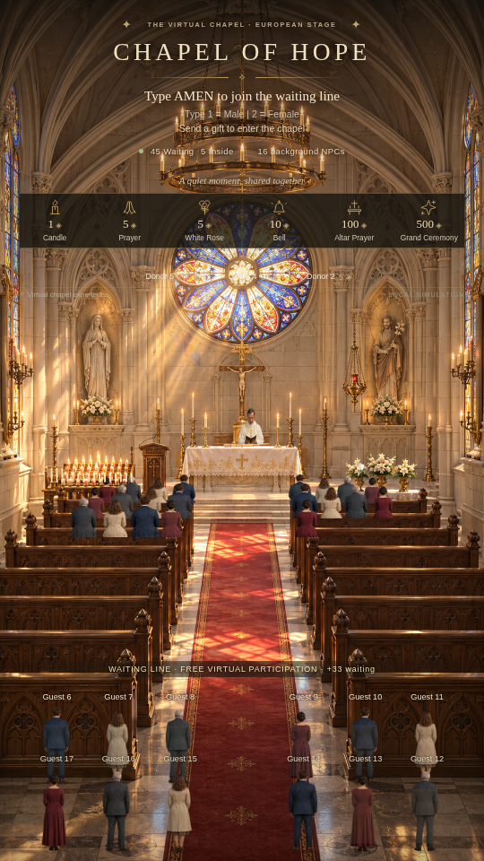

# Preview Task #06 — khung 9:16

Ảnh chụp trực tiếp từ bản build, không chỉnh ảnh sau chụp. NPC được tính riêng. Các bài quà dài dùng đồng hồ kiểm thử của engine để tới mốc hành trình; engine, route, FX và số liệu dùng đúng mã sản phẩm.

| Trạng thái | Ảnh |
|---|---|
| 20 AMEN vẫn chỉ ở hàng chờ sau 20 giây | [A-20-AMEN-waiting.png](A-20-AMEN-waiting.png) |
| Người được gift gọi đang đi từ hàng chờ | [B0-walking-from-line.png](B0-walking-from-line.png) |
| **50 AMEN, 5 người tặng: 45 chờ / 5 trong / 5 ghế** | [B-50-AMEN-only-5-inside.png](B-50-AMEN-only-5-inside.png) |
| Đổi avatar nữ khi đứng chờ, cùng ID | [C-gender-waiting.png](C-gender-waiting.png) |
| Quà 100 xu khi donor đã tới cung thánh | [D-altar-100.png](D-altar-100.png) |
| Quà 500 xu, cùng donor không tạo bản sao | [E-ceremony-500.png](E-ceremony-500.png) |
| Ghế đầy vẫn thực hiện quà | [F-full-seats-gift.png](F-full-seats-gift.png) |
| 100 AMEN + 20 quà: 80 chờ / 20 trong | [G-100-AMEN-20-gifts.png](G-100-AMEN-20-gifts.png) |
| Control, mixer, số liệu và danh sách chọn người | [control.png](control.png) |

[Kết quả UI/HTTP/WebSocket/AudioContext](results.json) · [Kết quả HTML offline](html-preview-results.json)

