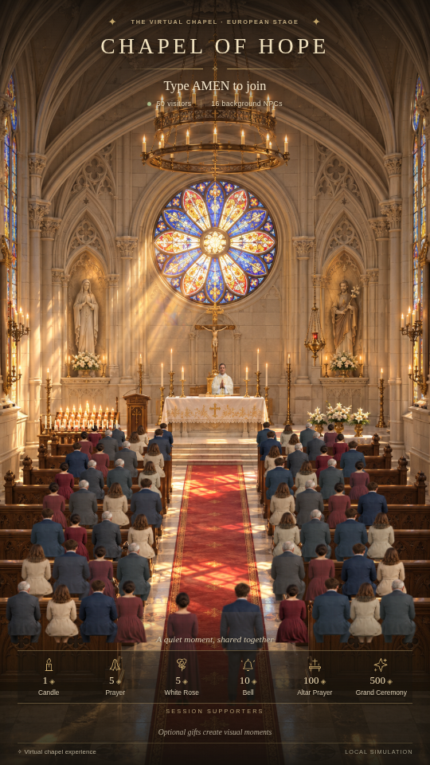
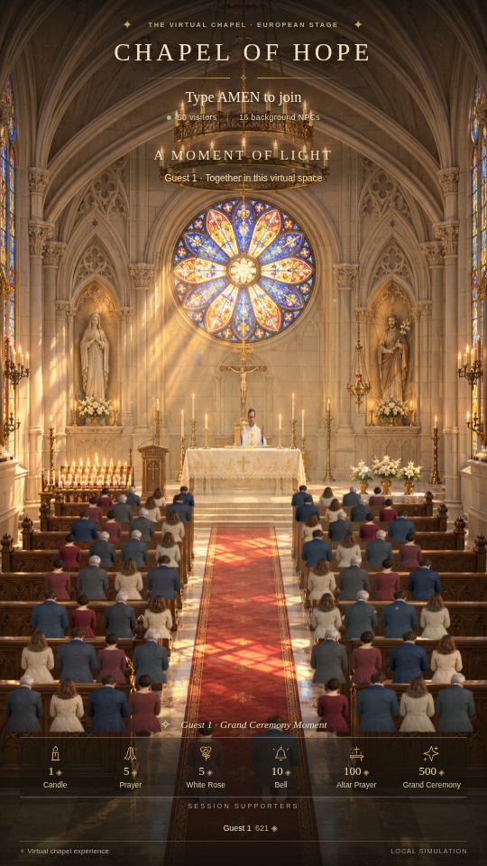

# Preview 2,5D — ảnh chụp trực tiếp từ trình duyệt

Mọi ảnh bên dưới là khung 9:16, không chỉnh sửa ảnh sau khi chụp. Cảnh dùng artwork gốc tạo riêng; số người và quà là trạng thái thật của engine mock. `control.png` là ảnh trang điều khiển dài, không phải nguồn phát.

| Trạng thái | Ảnh |
|---|---|
| Toàn cảnh, 50 khách + 16 NPC | [A-50-attendees.png](A-50-attendees.png) |
| Linh mục và bàn thờ, 16 NPC | [E-priest-and-altar.png](E-priest-and-altar.png) |
| 100 khách + 16 NPC | [crowd-100.png](crowd-100.png) |
| Giá nến, quà 1 xu | [B-candles.png](B-candles.png) |
| Quỳ, quà 5 xu | [B1-prayer.png](B1-prayer.png) |
| Dâng hoa, quà 5 xu | [B2-flowers.png](B2-flowers.png) |
| Chuông, quà 10 xu | [B3-bell.png](B3-bell.png) |
| Quà 100 xu | [C-altar-100.png](C-altar-100.png) |
| Quà 500 xu | [D-ceremony-500.png](D-ceremony-500.png) |
| Người đang đi vào | [G-arrival.png](G-arrival.png) |
| 100 người, High, 1080×1920 | [F-100-high-1080.png](F-100-high-1080.png) |
| Kết quả và cấu hình đo | [results.json](results.json) |

Các ảnh quà chụp ở 45% thời gian hiệu ứng bằng cách giữ đồng hồ snapshot trong script test. Người ở các ảnh đông được tạo với timestamp trước đó 120 giây để đã đi đến chỗ; đây không phải toàn bộ quá trình 100 người đi vào ngay lập tức. Kịch bản di chuyển riêng và các bài kiểm tra đường đi xác nhận tiến trình đến/rời chỗ. FPS được đo bằng thời gian thực, không giữ đồng hồ. Góc camera luôn là toàn cảnh nên ảnh nến vẫn giữ bàn thờ và chủ sự trong khung.
